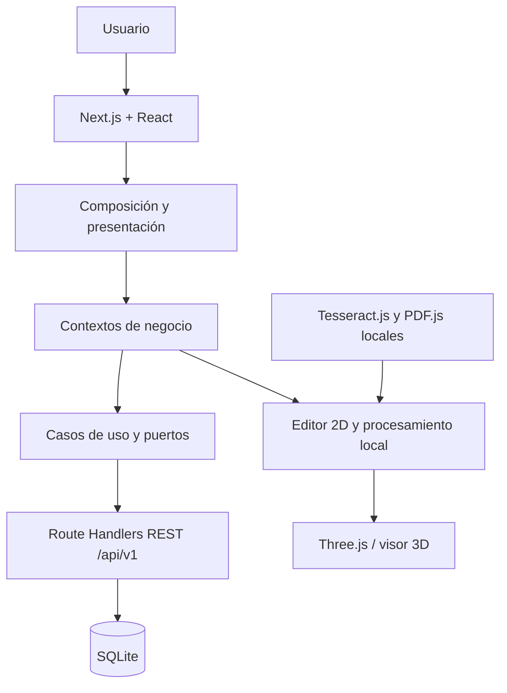

# Ark

Plataforma web para organizar, coordinar y dar seguimiento a proyectos de arquitectura desde un único espacio de trabajo.

> **Nombre del proyecto:** la aplicación y sus identificadores internos utilizan la marca **Ark**.

## Presentación

En pequeños y medianos estudios de arquitectura, la información de un proyecto suele quedar distribuida entre hojas de cálculo, correos, mensajes, carpetas y distintas versiones de un mismo documento. Esta dispersión dificulta conocer el avance real, identificar responsabilidades y conservar la trazabilidad de las decisiones.

Ark reúne en un mismo entorno la planificación, los documentos, los entregables, los costos, la comunicación del equipo y la participación del cliente. La plataforma también incorpora herramientas de diseño para importar y calibrar planos, trabajar con geometría 2D y visualizar una representación tridimensional del proyecto.

El objetivo no es reemplazar el criterio profesional del arquitecto, sino ofrecer una base ordenada para coordinar el trabajo y mantener accesible la información relevante de cada proyecto.

## ¿A quién está dirigida?

| Usuario | Necesidad principal | Participación en Ark |
| --- | --- | --- |
| Propietario o arquitecto responsable | Supervisar el proyecto y controlar el acceso | Administra el equipo, las tareas, los documentos, los costos, los entregables y las revisiones |
| Colaborador | Ejecutar y comunicar el trabajo asignado | Actualiza tareas, planos, documentos, incidencias y comentarios según sus permisos |
| Cliente | Conocer el avance compartido y tomar decisiones | Consulta entregables autorizados, revisa documentos y aprueba o solicita cambios |
| Personal administrativo | Dar seguimiento a fechas, costos y documentación | Consulta información operativa, partidas presupuestarias y reportes |

## Flujo general de uso

```mermaid
flowchart LR
    A[Crear cuenta o iniciar sesión] --> B[Crear proyecto o aceptar invitación]
    B --> C[Configurar equipo y roles]
    C --> D[Planificar tareas, hitos y calendario]
    D --> E[Trabajar con planos y documentos]
    E --> F[Registrar incidencias, comentarios y costos]
    F --> G[Preparar paquete de entrega]
    G --> H[Compartir con el cliente]
    H --> I[Aprobar o solicitar cambios]
    I --> J[Consultar historial y generar reporte]
    I -->|Requiere ajustes| D
```



### 1. Acceso y creación del espacio de trabajo

En la primera ejecución se registra la cuenta propietaria del estudio. Desde el portafolio se puede crear un proyecto, consultar los proyectos existentes o ingresar a uno mediante una invitación vigente.

Cada proyecto funciona como un espacio independiente. Los usuarios solo pueden consultar la información de los proyectos que crearon o a los que fueron incorporados.

### 2. Organización del equipo

El propietario invita arquitectos, colaboradores o clientes mediante enlaces con vencimiento. Los permisos se aplican tanto en la interfaz como en la API para evitar que un usuario acceda directamente a recursos no autorizados.

Los integrantes aceptados pueden ser asignados a tareas y revisiones. La carga de trabajo del equipo se presenta como información de apoyo para la coordinación.

### 3. Planificación

El equipo organiza el proyecto mediante:

- Tareas con responsable, disciplina, prioridad, estado y fecha límite.
- Hitos que representan revisiones o entregas importantes.
- Eventos del calendario del proyecto y agenda general del estudio.
- Dependencias fin-a-inicio entre tareas.
- Diagrama de Gantt y cálculo básico de la ruta crítica.

El sistema rechaza ciclos entre dependencias y puede impedir que una tarea avance cuando todavía tiene predecesoras incompletas.

### 4. Documentos y versiones

Los archivos se registran dentro de su proyecto y cada actualización genera una versión vinculada con la anterior. Esto permite conservar el origen de un entregable y evitar que un archivo nuevo sustituya silenciosamente el historial existente.

Las versiones gráficas compatibles pueden compararse mediante una superposición visual. Esta herramienta ayuda a observar diferencias, pero no realiza una interpretación semántica ni identifica automáticamente cambios arquitectónicos.

### 5. Coordinación y control

Durante el desarrollo se pueden registrar:

- Incidencias generales o relacionadas con un elemento del plano.
- Comentarios asociados al proyecto, una tarea, un documento o un elemento semántico.
- Partidas de presupuesto con cantidad, precio unitario y gasto real.
- Información referencial de proveedores y etapas.
- Notificaciones personales y cambios atribuidos a su autor.

El historial permite revisar quién realizó una modificación y cuándo ocurrió. No reemplaza una firma profesional ni una certificación documental.

### 6. Entregables y participación del cliente

El arquitecto agrupa versiones concretas de documentos en paquetes de entrega. Al compartir un paquete, el cliente puede acceder únicamente a la información autorizada y a las revisiones que le fueron asignadas.

El cliente puede aprobar un documento o solicitar cambios con observaciones. La decisión queda registrada con el usuario y la fecha reales de la sesión. El portal no muestra tareas internas, costos, integrantes ni el historial privado del estudio.

### 7. Seguimiento y cierre

El panel del proyecto resume el avance, los próximos hitos, las decisiones pendientes, los costos y la actividad reciente. Los responsables también pueden revisar retrasos, carga de trabajo, historial de cambios y descargar un reporte de estado en PDF.

## Funciones principales

| Área | Funciones disponibles |
| --- | --- |
| Portafolio | Creación de proyectos, búsqueda, filtros por fase y visualización en tarjetas o tabla |
| Identidad y acceso | Registro local, inicio y cierre de sesión, cookies HttpOnly y roles por proyecto |
| Equipo | Integrantes, invitaciones con vencimiento y revocación, roles y carga de trabajo |
| Tareas | Creación, edición, asignación, prioridades, disciplinas, estados y tablero Kanban |
| Planificación | Hitos, calendario, dependencias, Gantt y ruta crítica básica |
| Documentos | Carga de archivos, versiones inmutables, previsualización, descarga y comparación visual |
| Incidencias | Registro, seguimiento y relación opcional con elementos del plano |
| Presupuesto | Cantidades, precios unitarios, gasto real, etapas y proveedores de referencia |
| Colaboración | Comentarios contextualizados, visibilidad por rol y notificaciones personales |
| Entregables | Paquetes por etapa compuestos por versiones específicas de documentos |
| Aprobaciones | Solicitudes de revisión, aprobación o pedido de cambios y retroalimentación |
| Cliente | Portal restringido con documentos, modelos y entregables expresamente compartidos |
| Auditoría | Historial de cambios atribuido al usuario y registros no editables |
| Reportes | Reporte de estado del proyecto en PDF |
| Editor 2D | Geometría semántica de muros, habitaciones, aberturas y columnas |
| Importación de planos | PDF o imagen, corrección visual, calibración manual, OCR local y propuestas heurísticas |
| Visor 3D | Conversión de la geometría calibrada a una escena navegable con ajustes de calidad |
| Simulación | Representación educativa de una respuesta sísmica; no constituye análisis estructural |
| Idiomas y apariencia | Interfaz en español, inglés y portugués, modo claro y oscuro y diseño adaptable |

## Flujo de digitalización de planos

Ark utiliza un proceso asistido: el sistema propone y el usuario confirma. No presenta la detección automática como una verdad técnica.

1. El usuario importa un PDF, PNG, JPEG o WebP desde su equipo o selecciona un documento del proyecto.
2. PDF.js convierte la página elegida en una imagen de trabajo.
3. El usuario puede ajustar giro, perspectiva, contraste y reducción de ruido sin modificar el archivo original.
4. Dos puntos y una distancia conocida permiten establecer la escala métrica.
5. Un detector heurístico propone muros rectos y recintos rectangulares cerrados.
6. Tesseract.js puede reconocer textos en español, inglés o portugués de manera local.
7. El resultado se importa como borrador y cada elemento debe ser revisado por el usuario.
8. La geometría calibrada alimenta el visor 3D.

El reconocimiento actual no es un modelo de inteligencia artificial entrenado. No detecta de forma fiable muros diagonales o curvos, escaleras, múltiples niveles ni todos los símbolos arquitectónicos. Las medidas, alturas y clasificaciones requieren confirmación humana.

## Arquitectura implementada actualmente

La versión incluida en este repositorio funciona como una aplicación web integral ejecutada por Next.js. El frontend y la API REST se encuentran en el mismo proyecto, mientras que SQLite conserva los datos compartidos en el disco local.



### Domain-Driven Design y Clean Architecture

La solución está organizada mediante contextos delimitados. Cada contexto mantiene sus reglas, casos de uso, adaptadores y pantallas, evitando concentrar toda la lógica en componentes de interfaz o rutas HTTP.

La estructura general de un contexto es:

```text
bounded-contexts/<contexto>/
├── domain/          # Entidades, agregados, reglas y objetos de valor
├── application/     # Casos de uso y puertos
├── infrastructure/  # Repositorios y adaptadores técnicos
├── presentation/    # Pantallas, componentes y hooks
├── public.ts        # API de aplicación expuesta
└── index.ts         # Contrato público del módulo
```

Principios aplicados:

- El dominio no depende de la infraestructura ni de la interfaz.
- Los casos de uso trabajan con puertos definidos por su propio contexto.
- La infraestructura implementa esos puertos.
- Un contexto no accede a las rutas internas de otro; utiliza contratos públicos.
- La composición entre varios dominios se realiza en `src/composition`.
- Las páginas de Next.js seleccionan pantallas y las rutas de API delegan la lógica de negocio.

### Contextos funcionales

| Grupo | Contextos y responsabilidades |
| --- | --- |
| Gestión | Proyectos, tareas, hitos, cronograma, costos e incidencias |
| Documentación | Documentos, versiones, entregables, aprobaciones y reportes |
| Colaboración | Identidad, equipos, invitaciones, comentarios, notificaciones e historial de cambios |
| Diseño | Digitalización de planos, editor 2D, visualización espacial y simulación educativa |
| Administración | Perfil profesional, preferencias, soporte y configuración del espacio de trabajo |

### API REST

Los recursos compartidos se exponen bajo `/api/v1`. Las colecciones emplean sustantivos plurales en inglés y kebab-case; los campos persistidos utilizan snake_case. Algunos ejemplos son:

```text
/api/v1/users
/api/v1/sessions
/api/v1/projects
/api/v1/projects/{projectId}/tasks
/api/v1/projects/{projectId}/documents
/api/v1/projects/{projectId}/deliverable-packages
/api/v1/projects/{projectId}/comments
/api/v1/projects/{projectId}/blueprints
/api/v1/projects/{projectId}/reports
```

Las operaciones siguen las convenciones HTTP habituales: `GET`, `POST`, `PATCH` y `DELETE`. Las respuestas usan los sobres `{ "data": ... }` y `{ "error": ... }`.

### Persistencia y concurrencia

- La base de datos de ejecución se encuentra en `.data/ark.sqlite`.
- SQLite utiliza transacciones, modo WAL y tiempo de espera para operaciones concurrentes.
- Las reglas que relacionan recursos de varios módulos se validan dentro de la misma transacción.
- Los cambios utilizan revisiones optimistas mediante `ETag` e `If-Match`.
- Una actualización desactualizada se rechaza en lugar de sobrescribir el trabajo más reciente.
- Las preferencias personales, el terreno y algunos ajustes visuales todavía se conservan en el navegador.

No existe coedición simultánea en tiempo real. Si otro usuario guardó primero una versión del plano, el usuario debe actualizar la información antes de volver a guardar.

### Seguridad y permisos

- Contraseñas procesadas con `scrypt` y salt individual.
- Tokens de sesión almacenados como hash.
- Cookies de sesión HttpOnly y SameSite.
- Autorización independiente para cada proyecto y recurso.
- Invitaciones con token protegido, vencimiento y posibilidad de revocación.
- Registro del autor real desde la sesión; la API no confía en identidades enviadas por el cliente.
- Separación entre información interna y contenido compartido con clientes.

La versión actual está destinada a una instancia local de estudio y no debe exponerse directamente como un SaaS público sin completar las medidas indicadas en la sección de límites.

## Arquitectura backend planificada

La evolución prevista separará el backend actual de Next.js y trasladará las reglas y la persistencia principal a una aplicación dedicada.

| Componente | Tecnología prevista | Propósito |
| --- | --- | --- |
| Servicio backend | Java 21, Spring Boot y Maven | Implementar las reglas de negocio y los módulos de la aplicación |
| Estilo arquitectónico | Monolito modular | Mantener un solo despliegue con límites internos claros entre dominios |
| Punto de entrada | API Gateway | Centralizar el acceso y exponer endpoints con nomenclatura REST uniforme |
| Base de datos | PostgreSQL | Almacenar cuentas, proyectos, tareas, documentos, comentarios, entregables y demás información transaccional |
| Frontend | Next.js, React y TypeScript | Consumir la API y presentar los espacios de trabajo a cada tipo de usuario |

Esta arquitectura corresponde a la siguiente etapa del proyecto; no debe confundirse con la implementación actual basada en Route Handlers de Next.js y SQLite. La migración deberá incluir contratos REST versionados, scripts de base de datos, respaldo, validación de integridad y pruebas de integración.

## Tecnologías actuales

| Área | Tecnología |
| --- | --- |
| Aplicación web | Next.js 16, React 19 y TypeScript |
| Estilos | Tailwind CSS y estilos propios con temas claro/oscuro |
| API | Route Handlers de Next.js sobre Node.js |
| Persistencia | SQLite nativo |
| Visualización 3D | Three.js, React Three Fiber y Drei |
| PDF | PDF.js y PDF-Lib |
| OCR | Tesseract.js con español, inglés y portugués |
| Calidad | ESLint y Prettier |
| Pruebas | Suites de integración en Node.js y flujo de navegador con Playwright Core |

## Requisitos para ejecutar el proyecto

- Node.js 24 o posterior.
- npm.
- Navegador web moderno.
- Disco local con permisos de escritura.

Para el visor 3D se recomienda utilizar un navegador con WebGL habilitado. Una tarjeta gráfica dedicada no es obligatoria para los modelos demostrativos.

## Instalación y ejecución local

Desde la carpeta del frontend:

```bash
npm install
npm run dev
```

Después, abrir:

```text
http://localhost:3000/projects
```

En la primera visita, la aplicación solicitará la creación de la cuenta propietaria. Esa cuenta recibirá la propiedad de los proyectos migrados. Las cuentas posteriores únicamente verán proyectos propios o aquellos a los que hayan sido invitadas.

No se debe exponer la pantalla de configuración inicial en una red pública.

## Comandos disponibles

| Comando | Finalidad |
| --- | --- |
| `npm run dev` | Preparar recursos de planos e iniciar el entorno de desarrollo |
| `npm run build` | Preparar recursos y generar la compilación de producción |
| `npm run start` | Ejecutar una compilación existente |
| `npm run lint` | Revisar la calidad estática del código |
| `npm run test:workspace` | Probar recursos de gestión y persistencia |
| `npm run test:collaboration` | Probar autenticación, roles y flujos de colaboración |
| `npm run test:plans` | Probar calibración y reglas geométricas |
| `npm run test:plans:browser` | Probar en navegador el flujo de importación de planos |
| `npm run prepare:plans` | Preparar localmente PDF.js, Tesseract y sus modelos |

## Ejecución de pruebas aisladas

Para evitar que las pruebas modifiquen la base normal, se puede iniciar el servidor en modo QA:

```powershell
$env:ARK_TEST_MODE='1'
npm run dev -- --hostname 127.0.0.1 --port 3010
```

En otra terminal:

```bash
npm run test:workspace
npm run test:collaboration
npm run test:plans
npm run test:plans:browser
```

Los registros de prueba se guardan en `.data/qa/ark.sqlite`. Las pruebas verifican la cabecera del modo QA antes de crear información.

## Datos y copias de seguridad

En la primera inicialización, SQLite importa `.data/workspace-db.json` si existe; de lo contrario utiliza `data/workspace-db.json` como semilla. El archivo anterior se conserva sin modificaciones.

Para crear una copia consistente:

1. Detener el servidor.
2. Copiar el directorio `.data` completo.
3. Incluir los archivos auxiliares WAL de SQLite si están presentes.
4. Verificar periódicamente que el respaldo pueda restaurarse.

Los documentos y la base de datos no cuentan todavía con un sistema automático de copias cifradas.

## Estructura principal del repositorio

```text
frontend/
├── data/                       # Datos semilla versionados
├── docs/                       # Arquitectura, API y notas de aceptación
├── public/                     # Traducciones y recursos estáticos
├── scripts/                    # Preparación y pruebas de integración
├── src/
│   ├── app/                    # Páginas y rutas REST de Next.js
│   ├── bounded-contexts/       # Módulos del dominio
│   ├── composition/            # Orquestación entre contextos
│   ├── kernel/                 # Identidad, revisiones y persistencia compartida
│   └── shared/                 # Componentes y utilidades técnicas comunes
├── package.json
└── README.md
```

## Alcance y límites conocidos

Ark es actualmente un prototipo funcional para una instancia local de estudio, no un SaaS público listo para producción.

- Las invitaciones se comparten manualmente; no se envían correos.
- Las notificaciones son internas y se actualizan periódicamente o al recuperar el foco de la ventana; no usan WebSockets.
- No existe recuperación de contraseña ni verificación de correo electrónico.
- El almacenamiento de documentos no utiliza todavía un servicio de objetos escalable ni análisis antivirus.
- SQLite está pensado para la instancia local actual, no para múltiples servidores concurrentes.
- El Gantt utiliza dependencias fin-a-inicio y días calendario, sin nivelación de recursos.
- La comparación de versiones es visual; no interpreta automáticamente cambios del plano.
- La detección de planos y el OCR pueden equivocarse y requieren revisión humana.
- Los presupuestos son referenciales y no constituyen estimaciones certificadas.
- La simulación sísmica es educativa y no reemplaza un análisis estructural profesional.
- El visor 3D no constituye una validación normativa, BIM ni constructiva.

Antes de una publicación externa se deben incorporar, como mínimo, recuperación de identidad, verificación de cuentas, HTTPS, límites de solicitudes centralizados, almacenamiento seguro de archivos, copias de seguridad automatizadas, observabilidad y pruebas de seguridad.

## Documentación complementaria

- [Arquitectura del frontend](docs/architecture.md)
- [Contratos de la API REST](docs/rest-api.md)
- [Coordinación y entrega](docs/stage-two.md)
- [Digitalización y visualización de planos](docs/plan-digitization-and-rendering.md)

## Estado del proyecto

Ark demuestra un flujo completo de gestión y coordinación para proyectos arquitectónicos dentro de una instalación local: desde la creación del proyecto y la organización del equipo hasta la entrega, la decisión del cliente y el reporte final. La siguiente etapa técnica será consolidar el backend planificado con Java 21, Spring Boot, Maven y PostgreSQL, conservando los límites de dominio y los contratos REST ya definidos.
